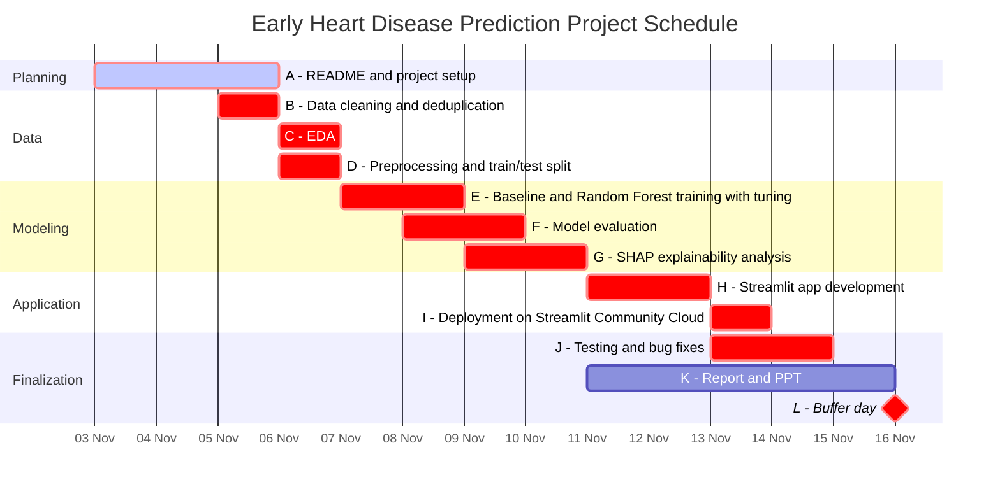

# Early Heart Disease Risk Prediction using Explainable Machine Learning


---

## 📌 Project Overview

* **Project Title:** Early Heart Disease Risk Prediction using Explainable Machine Learning
* **Core Concepts:** Supervised Classification, Random Forest Classifier, SHAP (SHapley Additive exPlanations)
* **Academic Context:** Data Science Working-Model Project, B.Tech CSE (Machine Learning and Data Science), Amity University Madhya Pradesh (AUMP)
* **Submission Deadline:** 16 November 2026

Cardiovascular diseases (CVDs) remain the leading cause of mortality worldwide. Early detection can save lives, but conventional "black-box" machine learning models often fail to gain clinician trust. This project builds a complete, reproducible clinical risk prediction pipeline using Random Forest classification paired with SHAP explainability. Every prediction is paired with intuitive local feature attribution—showing exactly which clinical indicators increased or decreased an individual patient's cardiovascular risk.

---

## 👥 Project Team

| Role | Member Name & Enrollment | Assigned Responsibilities | Owns |
| :--- | :--- | :--- | :--- |
| **Developer** | `[Your Name, Enrollment No.]` | End-to-end data pipeline, model training, SHAP explainability analysis, Streamlit application, and cloud deployment. | `src/`, `models/`, `data/`, later notebooks, deployment |
| **Teammate** | `[Name, Enrollment No.]` | Works independently; contributions to be updated. | EDA notebook, `reports/`, Streamlit UI pages |

---

## 🎯 Problem Statement and Objectives

### Problem Statement
Heart disease screening is critical for timely clinical intervention and preventive therapy. While standard machine learning algorithms can achieve high statistical performance, healthcare professionals cannot rely on opaque "black-box" predictions when patient care is at stake. To be clinically viable, an automated screening system must not only deliver high diagnostic sensitivity (recall) to minimize missed diagnoses (false negatives) but also provide granular, interpretable explanations for every individual risk prediction.

### Measurable Objectives
1. **Clean and Deduplicate Data:** Audit the dataset for structural anomalies, handle missing or corrupted values, and remove identical duplicate records prior to splitting to eliminate data leakage.
2. **Train Baseline and Candidate Models:** Establish a baseline with Logistic Regression and develop a hyperparameter-tuned Random Forest classifier.
3. **Optimize with Recall-Focused Metrics:** Evaluate models prioritizing Recall (Sensitivity), ROC-AUC, and F1-score to strictly minimize false negative predictions.
4. **Explain Predictions with SHAP:** Compute TreeSHAP values to yield both global feature importance (summary plots, feature importance rankings) and local explanations (patient-level waterfall plots).
5. **Deploy an Interactive Streamlit App:** Build and deploy a public-facing Streamlit web app providing real-time risk stratification and patient-specific SHAP explanation plots.

---

## 📊 Dataset Description

The project utilizes the widely studied **Kaggle Heart Disease Dataset** (derived from the classic Cleveland, Hungarian, Switzerland, and Long Beach V databases).

* **Total Records:** 1,025 rows
* **Feature Count:** 13 clinical predictors + 1 binary target column
* **Target Definition:** `target` (0 = No Heart Disease Present, 1 = Heart Disease Present)

### Feature Dictionary

| Feature Name | Clinical Description | Data Type | Permissible / Observed Range |
| :--- | :--- | :--- | :--- |
| `age` | Age of patient in years | Integer | 29 – 77 |
| `sex` | Biological sex (`1` = male, `0` = female) | Categorical (Binary) | 0, 1 |
| `cp` | Chest pain type (`0` = typical angina, `1` = atypical angina, `2` = non-anginal pain, `3` = asymptomatic) (value meanings differ between copies of this dataset and are not verified from the file itself) | Categorical (Nominal) | 0, 1, 2, 3 |
| `trestbps` | Resting blood pressure in mm Hg on hospital admission | Continuous (Integer) | 94 – 200 mm Hg |
| `chol` | Serum cholesterol level in mg/dl | Continuous (Integer) | 126 – 564 mg/dl |
| `fbs` | Fasting blood sugar > 120 mg/dl (`1` = true, `0` = false) | Categorical (Binary) | 0, 1 |
| `restecg` | Resting electrocardiographic results (`0` = normal, `1` = ST-T wave abnormality, `2` = probable or definite left ventricular hypertrophy) | Categorical (Nominal) | 0, 1, 2 |
| `thalach` | Maximum heart rate achieved during stress test | Continuous (Integer) | 71 – 202 bpm |
| `exang` | Exercise-induced angina (`1` = yes, `0` = no) | Categorical (Binary) | 0, 1 |
| `oldpeak` | ST depression induced by exercise relative to rest | Continuous (Float) | 0.0 – 6.2 |
| `slope` | Slope of the peak exercise ST segment (`0` = upsloping, `1` = flat, `2` = downsloping) (value meanings differ between copies of this dataset and are not verified from the file itself) | Categorical (Nominal) | 0, 1, 2 |
| `ca` | Number of major vessels (0–3) colored by fluoroscopy | Discrete (Integer) | ca = 4 (4 rows) and thal = 0 (2 rows) occur in the data and are treated as missing |
| `thal` | Thalassemia status (`1` = normal, `2` = fixed defect, `3` = reversible defect) (value meanings differ between copies of this dataset and are not verified from the file itself) | Categorical (Nominal) | ca = 4 (4 rows) and thal = 0 (2 rows) occur in the data and are treated as missing |
| `target` | Original label column from the Kaggle file. Audit evidence in this file indicates target = 1 corresponds to ABSENCE of heart disease. The project uses a derived column 'disease' = 1 - target (1 = disease present). | Binary Target | 0, 1 |

### Known Data Issues
* **Duplicate Observations:** The raw 1,025-row dataset contains repeated observations representing approximately 300 unique clinical patients.
* **Leakage Prevention:** To avoid synthetic performance inflation and severe data leakage between training and testing sets, **all duplicate records are purged strictly BEFORE the train/test split**.
* **Audit & Verification:** The exact count of unique instances will be verified systematically in code during Phase 1 and recorded directly into the project's Results section.
* **Encoding verification:** The value codes in the feature dictionary (for example thal, slope, cp and the direction of target) will be verified against the actual file in Phase 1 and corrected here if they differ.
* Label direction: the audit showed target = 1 groups have higher thalach, lower oldpeak, lower exercise angina and ca = 0 more often, which is the clinical pattern of healthy patients. The project therefore uses disease = 1 - target. A sanity check after training verifies this.
* Invalid codes: ca = 4 and thal = 0 are converted to missing values and imputed with the most frequent training value.
* Small test set: with 302 unique patients the test split has about 61 rows, so test metrics are noisy and are reported together with cross-validation results.

---

## 🛠️ Tech Stack & Tooling

* **Python 3.11:** Core execution language offering robust performance, broad library compatibility, and typing stability.
* **pandas:** High-performance tabular data structures for data ingestion, deduplication, and transformation.
* **numpy:** Vectorized numerical operations and multi-dimensional array support.
* **scikit-learn:** Comprehensive machine learning suite for data preprocessing, baseline model training, hyperparameter grid search, and evaluation metrics.
* **SHAP:** Game-theoretic feature attribution library utilizing TreeExplainer to produce interpretable global and local model explanations.
* **matplotlib:** Foundational plotting library for formatting and rendering diagnostic visual evaluations.
* **seaborn:** Statistical data visualization library for correlation heatmaps and feature distributions.
* **joblib:** Serialization engine for persistent storage and rapid reloading of trained model artifacts and preprocessing scalers.
* **Streamlit:** Python-native framework for rapid development of interactive, clinician-friendly web applications.
* **GitHub:** Version control repository hosting project code, documentation, and revision tracking.
* **Streamlit Community Cloud:** Managed cloud hosting environment enabling continuous public web app accessibility directly from GitHub.
* **Antigravity:** AI coding assistant utilized prompt-by-prompt across planning, code generation, debugging, and documentation stages.

---

## 🔄 Project Workflow

The project executes through eight sequential, modular phases:

```
[Phase 1: Ingestion & Deduplication] ➡️ [Phase 2: EDA] ➡️ [Phase 3: Preprocessing & Split]
                                                                        ⬇️
[Phase 6: SHAP Explainability] ⬅️ [Phase 5: Evaluation] ⬅️ [Phase 4: Model Training]
             ⬇️
[Phase 7: Streamlit App] ➡️ [Phase 8: Cloud Deployment]
```

1. **Phase 1: Data Loading, Validation, and Deduplication**
   * **Goal:** Inspect schema, detect duplicate rows, validate ranges, and deduplicate dataset.
   * **Input:** `data/raw/heart.csv`
   * **Output Files:** `data/processed/heart_deduplicated.csv`, `reports/data_audit_summary.json`

2. **Phase 2: Exploratory Data Analysis (EDA)**
   * **Goal:** Examine class balance, correlations, feature distributions, and clinical trends.
   * **Input:** `data/processed/heart_deduplicated.csv`
   * **Output Files:** `notebooks/01_eda.ipynb`, `reports/figures/correlation_matrix.png`, `reports/figures/feature_distributions.png`

3. **Phase 3: Data Preprocessing and Partitioning**
   * **Goal:** Handle anomalies/outliers, encode categorical features, scale numerical features, and perform a stratified train/test split (`random_state=42`).
   * **Input:** `data/processed/heart_deduplicated.csv`
   * **Output Files:** `data/processed/X_train.csv`, `data/processed/X_test.csv`, `data/processed/y_train.csv`, `data/processed/y_test.csv`, `models/preprocessor.joblib`

4. **Phase 4: Baseline & Candidate Model Training**
   * **Goal:** Train a Logistic Regression baseline and conduct cross-validated hyperparameter tuning (`GridSearchCV`) for a Random Forest classifier.
   * **Input:** `data/processed/X_train.csv`, `data/processed/y_train.csv`
   * **Output Files:** `models/baseline_logistic_regression.joblib`, `models/best_random_forest.joblib`, `models/training_history.json`

5. **Phase 5: Model Evaluation & Benchmarking**
   * **Goal:** Compute classification metrics (Accuracy, Precision, Recall, F1, ROC-AUC, Brier score) and confusion matrices on unseen test data, prioritizing high sensitivity.
   * **Input:** `models/best_random_forest.joblib`, `data/processed/X_test.csv`, `data/processed/y_test.csv`
   * **Output Files:** `reports/metrics_comparison.csv`, `reports/figures/confusion_matrix.png`, `reports/figures/roc_curve.png`

6. **Phase 6: SHAP Explainability Analysis**
   * **Goal:** Extract TreeSHAP values for the test partition; produce global summary/bar plots and local single-patient waterfall explanation charts.
   * **Input:** `models/best_random_forest.joblib`, `data/processed/X_test.csv`
   * **Output Files:** `models/shap_explainer.joblib`, `reports/figures/shap_summary_plot.png`, `reports/figures/shap_bar_plot.png`

7. **Phase 7: Streamlit Application Development**
   * **Goal:** Build a modular, interactive user interface supporting single-patient inference, risk tier classification, and dynamic local SHAP waterfall diagrams.
   * **Input:** `models/best_random_forest.joblib`, `models/preprocessor.joblib`, `models/shap_explainer.joblib`
   * **Output Files:** `app/app.py`, `app/utils.py`, `app/components.py`

8. **Phase 8: Production Deployment**
   * **Goal:** Connect GitHub repository with Streamlit Community Cloud and verify end-to-end cloud accessibility.
   * **Input:** GitHub Repository (`main` branch), `requirements.txt`
   * **Output Files:** Production URL, `reports/deployment_checklist.md`

---

## 💻 Web Application Features

* **Interactive Clinical Parameter Sidebar:** Responsive entry fields for all 13 clinical variables with strict input boundary validations and plain-English tooltips.
* **Stratified Risk Indicator:** Outputs real-time predicted probability categorized into intuitive risk tiers:
  * 🟢 **Low Risk:** $< 35\%$
  * 🟡 **Moderate Risk:** $35\% - 65\%$
  * 🔴 **High Risk:** $> 65\%$
* **Patient-Specific SHAP Waterfall Plot:** Granular visualization highlighting factors pushing predicted risk upward (red) or downward (blue) relative to baseline prevalence.
* **Global Model Insights & Metrics:** Dedicated view displaying model architecture, cross-validation metrics, confusion matrices, and global feature importance.
* **Dataset & Methodology Overview:** Clear documentation on clinical features, cleaning procedures, and performance benchmarks.
* **Mandatory Medical Disclaimer:** Prominent alert reminding users that the software is strictly an academic demonstration and not a substitute for professional clinical diagnosis.

---

## 📁 Repository Directory Structure

```text
heart-disease-prediction/
├── data/
│   ├── raw/                 # Original, untouched Kaggle heart.csv
│   └── processed/           # Deduplicated, cleaned, and split datasets
├── notebooks/               # Jupyter notebooks for interactive EDA and modeling experiments
├── src/                     # Reusable production source code (cleaning, training, SHAP utilities)
├── models/                  # Serialized joblib pipelines, model weights, and explainer objects
├── app/                     # Multi-page Streamlit web application source code
├── reports/                 # Generated evaluation metrics, figures, and presentation artifacts
│   └── figures/             # Exported PNG plots (ROC curves, confusion matrices, SHAP charts)
├── requirements.txt         # Pinned project dependencies and environment specification
└── README.md                # Comprehensive project documentation and execution guide
```

---

## 📅 Project Schedule (Gantt Chart)



---

## 📈 PERT Analysis

Project Evaluation and Review Technique (PERT) manages task variability and quantifies project duration confidence.

### Part 1: PERT Activity Estimates Table

$$\mu = T_E = \frac{O + 4M + P}{6}, \quad \sigma^2 = \left(\frac{P - O}{6}\right)^2$$

| Task ID | Task Description | Predecessors | Optimistic $O$ (days) | Most Likely $M$ (days) | Pessimistic $P$ (days) | Expected Time $T_E$ (days) | Variance $\sigma^2$ |
| :---: | :--- | :---: | :---: | :---: | :---: | :---: | :---: |
| **A** | README and project setup | None | 1.0 | 2.0 | 3.0 | **2.00** | $\frac{4}{36} \approx 0.1111$ |
| **B** | Data cleaning and deduplication | A | 0.5 | 1.0 | 1.5 | **1.00** | $\frac{1}{36} \approx 0.0278$ |
| **C** | Exploratory Data Analysis (EDA) | B | 0.5 | 1.0 | 1.5 | **1.00** | $\frac{1}{36} \approx 0.0278$ |
| **D** | Preprocessing and train/test split | B | 0.5 | 1.0 | 1.5 | **1.00** | $\frac{1}{36} \approx 0.0278$ |
| **E** | Baseline & Random Forest training with tuning | C, D | 1.0 | 1.5 | 2.0 | **1.50** | $\frac{1}{36} \approx 0.0278$ |
| **F** | Model evaluation | E | 0.5 | 1.0 | 1.5 | **1.00** | $\frac{1}{36} \approx 0.0278$ |
| **G** | SHAP explainability analysis | F | 1.0 | 1.5 | 2.0 | **1.50** | $\frac{1}{36} \approx 0.0278$ |
| **H** | Streamlit app development | G | 1.0 | 2.0 | 3.0 | **2.00** | $\frac{4}{36} \approx 0.1111$ |
| **I** | Deployment on Streamlit Community Cloud | H | 0.5 | 1.0 | 1.5 | **1.00** | $\frac{1}{36} \approx 0.0278$ |
| **J** | Testing and bug fixes | I | 1.0 | 1.5 | 2.0 | **1.50** | $\frac{1}{36} \approx 0.0278$ |
| **K** | Report and presentation preparation | G | 1.0 | 2.0 | 3.0 | **2.00** | $\frac{4}{36} \approx 0.1111$ |
| **L** | Final review & buffer day | J, K | 1.0 | 1.0 | 1.0 | **1.00** | $\frac{0}{36} = 0.0000$ |

---

### Part 2: PERT Network Diagram

```mermaid
flowchart LR
    classDef crit fill:#ffebee,stroke:#d32f2f,stroke-width:2.5px,color:#b71c1c;
    classDef noncrit fill:#f5f5f5,stroke:#9e9e9e,stroke-width:1.5px,color:#424242;

    A["<b>A: README & Setup</b><br>TE = 2.0d"]:::crit
    B["<b>B: Data Cleaning</b><br>TE = 1.0d"]:::crit
    C["<b>C: EDA</b><br>TE = 1.0d"]:::crit
    D["<b>D: Preprocessing & Split</b><br>TE = 1.0d"]:::crit
    E["<b>E: Model Training & Tuning</b><br>TE = 1.5d"]:::crit
    F["<b>F: Model Evaluation</b><br>TE = 1.0d"]:::crit
    G["<b>G: SHAP Analysis</b><br>TE = 1.5d"]:::crit
    H["<b>H: Streamlit App</b><br>TE = 2.0d"]:::crit
    I["<b>I: Deployment</b><br>TE = 1.0d"]:::crit
    J["<b>J: Testing & Bug Fixes</b><br>TE = 1.5d"]:::crit
    K["<b>K: Report & PPT</b><br>TE = 2.0d"]:::noncrit
    L["<b>L: Buffer Day</b><br>TE = 1.0d"]:::crit

    A --> B
    B --> C
    B --> D
    C --> E
    D --> E
    E --> F
    F --> G
    G --> H
    H --> I
    I --> J
    G -.-> K
    J --> L
    K -.-> L

    linkStyle 0,1,2,3,4,5,6,7,8,9,11 stroke:#d32f2f,stroke-width:2.5px;
    linkStyle 10,12 stroke:#9e9e9e,stroke-width:1.5px,stroke-dasharray: 4 4;
```



> **Diagram Legend:**  
> * 🔴 **Solid red nodes and arrows:** Critical path (slack = 0)  
> * ⚪ **Grey node with dashed arrows:** non-critical task (slack > 0)

---

### Part 3: Critical Path Analysis

Forward and backward passes evaluate schedule float across the workflow:

| Task ID | Task Description | Expected $T_E$ | Earliest Start (ES) | Earliest Finish (EF) | Latest Start (LS) | Latest Finish (LF) | Total Slack ($LS - ES$) | Critical Path? |
| :---: | :--- | :---: | :---: | :---: | :---: | :---: | :---: | :---: |
| **A** | README and project setup | 2.00 | 0.00 | 2.00 | 0.00 | 2.00 | **0.00** | **Yes** |
| **B** | Data cleaning and deduplication | 1.00 | 2.00 | 3.00 | 2.00 | 3.00 | **0.00** | **Yes** |
| **C** | Exploratory Data Analysis | 1.00 | 3.00 | 4.00 | 3.00 | 4.00 | **0.00** | **Yes** (tied) |
| **D** | Preprocessing and train/test split | 1.00 | 3.00 | 4.00 | 3.00 | 4.00 | **0.00** | **Yes** (tied) |
| **E** | Model training and tuning | 1.50 | 4.00 | 5.50 | 4.00 | 5.50 | **0.00** | **Yes** |
| **F** | Model evaluation | 1.00 | 5.50 | 6.50 | 5.50 | 6.50 | **0.00** | **Yes** |
| **G** | SHAP explainability analysis | 1.50 | 6.50 | 8.00 | 6.50 | 8.00 | **0.00** | **Yes** |
| **H** | Streamlit app development | 2.00 | 8.00 | 10.00 | 8.00 | 10.00 | **0.00** | **Yes** |
| **I** | Deployment on Streamlit Cloud | 1.00 | 10.00 | 11.00 | 10.00 | 11.00 | **0.00** | **Yes** |
| **J** | Testing and bug fixes | 1.50 | 11.00 | 12.50 | 11.00 | 12.50 | **0.00** | **Yes** |
| **K** | Report and PPT preparation | 2.00 | 8.00 | 10.00 | 10.50 | 12.50 | **2.50** | No |
| **L** | Buffer day | 1.00 | 12.50 | 13.50 | 12.50 | 13.50 | **0.00** | **Yes** |

#### Summary & Statistical Parameters
* **Critical Path Sequence:** $\text{A} \rightarrow \text{B} \rightarrow \{\text{C}, \text{D}\} \rightarrow \text{E} \rightarrow \text{F} \rightarrow \text{G} \rightarrow \text{H} \rightarrow \text{I} \rightarrow \text{J} \rightarrow \text{L}$
* **Parallel Criticality Tie:** Tasks **C** and **D** run in parallel and share identical durations ($T_E = 1.00\text{ day}$) and dependencies; both share zero float and tie for criticality.
* **Non-Critical Path Slack:** Task **K** (Report and PPT preparation) operates in parallel with the application pipeline (**H**, **I**, and **J**). Because the application chain requires $2.0 + 1.0 + 1.5 = 4.5\text{ days}$ versus $2.0\text{ days}$ for Task **K**, Task **K** possesses **2.50 days of total slack** ($\text{LS} = 10.50$, $\text{ES} = 8.00$).
* **Total Expected Project Duration ($T_{\text{proj}}$):**
  $$T_{\text{proj}} = 2.0 + 1.0 + 1.0 + 1.5 + 1.0 + 1.5 + 2.0 + 1.0 + 1.5 + 1.0 = \mathbf{13.50\text{ days}}$$
* **Critical Path Total Variance ($\sigma^2_{\text{CP}}$):**
  $$\sigma^2_{\text{CP}} = \sigma^2_A + \sigma^2_B + \sigma^2_{C/D} + \sigma^2_E + \sigma^2_F + \sigma^2_G + \sigma^2_H + \sigma^2_I + \sigma^2_J + \sigma^2_L$$
  $$\sigma^2_{\text{CP}} = \frac{4 + 1 + 1 + 1 + 1 + 1 + 4 + 1 + 1 + 0}{36} = \frac{15}{36} \approx \mathbf{0.417}$$
* **Project Standard Deviation ($\sigma_{\text{CP}}$):**
  $$\sigma_{\text{CP}} = \sqrt{0.4167} \approx \mathbf{0.65\text{ days}}$$

---

## 🤝 Contributing

We welcome team collaboration! Please consult [CONTRIBUTING.md](CONTRIBUTING.md) for branch guidelines, notebook hygiene, and ownership policies.
All feature work must be performed on dedicated branches (`feature/<yourname>-<task>`) and merged into `main` exclusively through a reviewed Pull Request.
Direct commits to `main` are strictly disallowed to prevent merge conflicts and preserve deployment stability.

---

## 🚀 Setup and Installation Guide

### Prerequisites
* Python 3.11 or higher
* Git command line utility

### 1. Clone the Repository
```bash
git clone https://github.com/[Your-Username]/heart-disease-prediction.git
cd heart-disease-prediction
```

### 2. Create and Activate Virtual Environment
* **Windows (Command Prompt / PowerShell):**
  ```powershell
  python -m venv venv
  .\venv\Scripts\activate
  ```
* **macOS / Linux:**
  ```bash
  python3 -m venv venv
  source venv/bin/activate
  ```

### 3. Install Dependencies
```bash
pip install --upgrade pip
pip install -r requirements.txt
```

### 4. Launch the Streamlit Application
```bash
streamlit run app/app.py
```
Open your web browser and navigate to `http://localhost:8501`.

---

## 📋 Project Execution Checklist

- [x] **Phase 1:** Data loading, schema validation, and deduplication audit
- [ ] **Phase 2:** Exploratory data analysis & statistical correlation reporting
- [x] **Phase 3:** Feature encoding, scaling, and stratified train/test split
- [x] **Phase 4:** Baseline Logistic Regression & tuned Random Forest training
- [ ] **Phase 5:** Model evaluation with recall, ROC-AUC, and confusion matrix benchmarking
- [ ] **Phase 6:** Global and local SHAP explainability visualizations
- [ ] **Phase 7:** Streamlit interactive dashboard development and validation
- [ ] **Phase 8:** Streamlit Community Cloud production deployment & documentation

---

## 🔬 Experimental Results & Evaluation

*(All fields will be updated upon completion of Phase 1, Phase 4, and Phase 5 experiments).*

### Data Audit Summary
* Raw record count: `1025`
* Duplicate rows detected: `723` (70.54%)
* Verified unique patient records: `302` (29.46%)
* Disease present (disease = 1, i.e. target = 0): 45.70% (n=138); disease absent: 54.30% (n=164)

### Model Performance Comparison

| Model | Accuracy | Precision | Recall (Sensitivity) | F1-Score | ROC-AUC |
| :--- | :---: | :---: | :---: | :---: | :---: |
| **Logistic Regression (Baseline)** | `[Pending]` | `[Pending]` | `[Pending]` | `[Pending]` | `[Pending]` |
| **Random Forest (Tuned Candidate)** | `[Pending]` | `[Pending]` | `[Pending]` | `[Pending]` | `[Pending]` |

### Evaluation Artifacts
* `[Placeholder: Test Set Confusion Matrix Plot]`
* `[Placeholder: ROC Curve Comparison Chart]`
* `[Placeholder: Global SHAP Summary Beeswarm Plot]`
* `[Placeholder: Exemplar Patient Local SHAP Waterfall Plot]`

---

## ⚠️ Limitations

1. **Small Unique Sample Size:** After purging duplicate patient records, the dataset comprises only approximately 300 unique individuals, limiting statistical power and high-dimensional generalization.
2. **Single-Source Regional Bias:** Data collection originates from historical clinical cohorts that do not adequately reflect modern heterogeneous demographic, socioeconomic, or regional populations.
3. **Absence of Clinical Validation:** Predictions are produced solely as an academic machine learning benchmark and have not been validated in a prospective clinical trial.

---

## 🔮 Future Scope

* **External Cohort Validation:** Ingest and benchmark models against modern open medical cohorts (e.g., UK Biobank, PhysioNet, MIMIC-IV).
* **Deep Tabular Architectures:** Benchmark Random Forest against gradient boosting ensembles (XGBoost, LightGBM, CatBoost) and TabNet architectures.
* **Calibrated Uncertainty Estimation:** Implement conformal prediction intervals to provide reliable prediction confidence bounds alongside point probabilities.
* **FHIR/EHR Integration:** Design compliant HL7/FHIR microservice endpoints to interface risk prediction with hospital information management systems.

---

## 📚 References

1. **Kaggle Dataset Source:** [Heart Disease Dataset (Cleveland & Aggregated)](https://www.kaggle.com/datasets/johnsmith88/heart-disease-dataset).
2. **Clinical Origin:** Detrano, R., et al. (1989). *International application of a new probability algorithm for the diagnosis of coronary artery disease*. American Journal of Cardiology, 64(5), 304–310. [UCI Machine Learning Repository](https://archive.ics.uci.edu/dataset/45/heart+disease).
3. **Explainable AI (SHAP):** Lundberg, S. M., & Lee, S.-I. (2017). *A Unified Approach to Interpreting Model Predictions*. Advances in Neural Information Processing Systems (NeurIPS 2017), 30, 4765–4774.
4. **Machine Learning Framework:** Pedregosa, F., et al. (2011). *Scikit-learn: Machine Learning in Python*. Journal of Machine Learning Research, 12, 2825–2830.
5. **PERT Methodology:** Malcolm, D. G., Roseboom, J. H., Clark, C. E., & Fazar, W. (1959). *Application of a Technique for Research and Development Program Evaluation*. Operations Research, 7(5), 646–669.

---

### ⚖️ Disclaimer
*This software and associated documentation are developed exclusively for academic and educational evaluation in partial fulfillment of the B.Tech CSE (Machine Learning and Data Science) curriculum at Amity University Madhya Pradesh. It is not an FDA-approved medical diagnostic device and must not be used to direct or determine patient diagnosis, medical management, or clinical interventions.*

